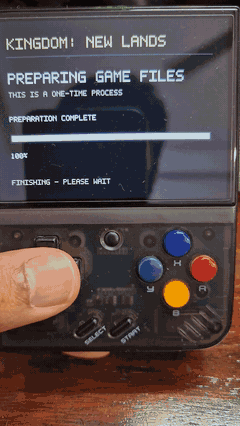
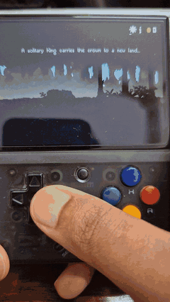

# 👑 Kingdom: New Lands on Miyoo Mini / Mini Plus

Build your kingdom on OnionOS. Bring the files from your own PC copy of **Kingdom: New Lands**.

**Version: 1.1.0** · [📦 Downloads](https://github.com/devarshi16/kingdom-miyoo/releases) · [🐛 Report an issue](https://github.com/devarshi16/kingdom-miyoo/issues)

## 🎮 Player installation

1. **Extract the complete release ZIP onto your SD card root.** Merge its `Roms` folder with the one already on your card.
2. **Copy your original `Kingdom_Data` folder** into `Roms/PORTS/Games/KingdomNewLands/`, beside `knl.sh`.
3. **Safely eject the card and launch Kingdom New Lands from Ports.** Refresh Ports if it does not appear.

Your folders should look like this:

```text
Roms/PORTS/Games/KingdomNewLands/
├── knl.sh
└── Kingdom_Data/
    └── Managed/Assembly-CSharp.dll
```

⏳ **First launch prepares the game files once.** Keep the Miyoo charged and wait for the game to open. Our fresh-install test took about **12 minutes**; your SD card may differ. Press **B** to pause preparation and launch again to resume.

| First launch finishing | Gameplay on the Miyoo |
| :---: | :---: |
|  |  |

## 🤖 AI installation

Using an AI assistant that can access files on your computer? Paste this prompt and provide your game-folder and SD-card locations:

```text
Help me install Kingdom: New Lands on my Miyoo Mini Plus:
https://github.com/devarshi16/kingdom-miyoo

Follow the repository's README and use the complete release ZIP.
I will provide my original Kingdom_Data folder and SD card location.
Back up existing saves, copy the release and original files to the
correct locations, and verify the folder layout. Do not format the
card or change other games. Tell me what to launch on the Miyoo.
```

## 🕹️ Controls

| Action | Button |
| --- | --- |
| Move | D-pad |
| Pay | Down / A / X |
| Gallop | B / L / R |
| Pause menu | Start |
| Confirm / Back | A / B or Select |
| Emergency exit to Onion | Menu + Start — use the game's save option first |

## 💾 Saves and updates

Your saves are in `Roms/PORTS/Games/KingdomNewLands/save/`. **Back up this folder before updating.** Then copy the new release's `Roms` folder onto the SD card. An existing prepared installation can launch without preparing the original files again.

## 🐛 Help and known issues

Heavy battles can still slow down. The coin counter and lighter effects help performance. See [known limitations and testing results](docs/VALIDATION-1.1.0-rc6.md).

If something goes wrong, [open an issue](https://github.com/devarshi16/kingdom-miyoo/issues) with your Onion version, game source and what happened. Attach `logs/prepare.log` for preparation errors or `logs/knl.log` for game errors, from the game folder. Check logs for personal paths before sharing.

Want to contribute? See the [development guide](docs/DEVELOPMENT.md).

Kingdom: New Lands belongs to Noio and Raw Fury. This independent port is not endorsed by them. Original game files are not included.

## 💻 Command-line alternative — for avoiding on-device setup

Prepare the files on your PC instead. Extract the **complete release ZIP** to a writable folder and open a terminal there. You need **Python 3.11**, **FFmpeg** on PATH and internet for the initial dependencies.

**Linux / macOS:**

```bash
python3 -m venv .player-venv
.player-venv/bin/python -m pip install -r tools/requirements.txt
.player-venv/bin/python prepare_data.py "/path/to/Kingdom_Data" --out "/path/to/SD-root"
```

<details>
<summary>Windows PowerShell commands</summary>

```powershell
py -3.11 -m venv .player-venv
.\.player-venv\Scripts\python.exe -m pip install -r tools\requirements.txt
.\.player-venv\Scripts\python.exe prepare_data.py "C:\path\Kingdom_Data" --out "E:\"
```

</details>

Prefer a folder picker? Run `setup_windows.bat` on Windows or `./setup.sh` on Linux/macOS. [PC setup details](docs/DEVELOPMENT.md#pc-preparation-support).

## 📂 Supported data

Verified with **Kingdom: New Lands 1.2.8 / Unity 2017.1.2p1**. The installer checks your files and explains any mismatch. A store name alone does not guarantee the same build.

<details>
<summary>Common places to find Kingdom_Data on Windows</summary>

- **Steam:** `C:\Program Files (x86)\Steam\steamapps\common\Kingdom New Lands\Kingdom_Data`
- **GOG:** `C:\GOG Games\Kingdom New Lands\Kingdom_Data`
- **Epic:** `C:\Program Files\Epic Games\KingdomNewLands\Kingdom_Data`

Other library locations work too—select your game's `Kingdom_Data` folder.

</details>
