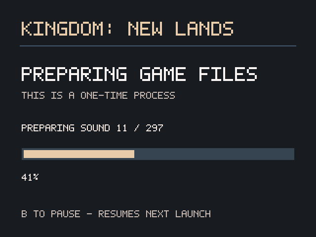

# First-launch preparation

The complete converter is implemented and connected to the Onion launcher. It reads the owner's original `Kingdom_Data` folder on the SD card. Players need no compiler, Python, FFmpeg, SSH or internet connection. The earlier `native_index.c` remains a developer-only header/index probe; it is not the installed converter.

## Player route

Extract the full release ZIP onto the SD root. Copy the complete original `Kingdom_Data` into `Roms/PORTS/Games/KingdomNewLands/Kingdom_Data`. Launch Kingdom New Lands from Ports. The screen displays **PREPARING GAME FILES**, **THIS IS A ONE-TIME PROCESS**, the current stage and a percentage. Sound conversion is the longest stage. The tested stock-clock card took **12 minutes 18 seconds** for a fresh preparation. Other cards/configurations can differ. Keep the device charged. B pauses conversion; relaunching reuses verified checkpoints. During final activation the screen asks the player to wait and stops accepting cancellation.

Only the fingerprinted PC build 1.2.8 / Unity 2017.1.2p1 is supported. The importer checks 40 serialized, managed and resource files and rechecks source consistency before activation. Missing or mismatched files stop with a readable error and A retry / B exit. Copying an executable alone is insufficient. A new card must have at least 192 MiB free **after** copying the runtime and original folder. Existing installed data, originals and rollback copies also consume space.

The shortcut checks for the shipped `knl.sh`, allowing first launch before `kingdom.knlpack` exists. `knl.sh` validates the public runtime, recovers interrupted activation, then either launches prepared data or opens the preparation screen. A verified existing PC-prepared installation can start without the raw folder. Public runtime updates do not force importing unchanged owned data again.

Logs: `logs/prepare-check.log`, `logs/prepare.log`, and then `logs/knl.log`. Review logs for local paths before sharing. The raw folder, pack, game DLLs, saves, staging and screenshots are private owner data.

The preparation screen captured on the Miyoo:

## Conversion and memory design

- Nine format-17 serialized files contain 16,880 objects, including 4,357 MonoBehaviours. Mono.Cecil inspects original assemblies as metadata; it does not load or execute their code. Original Unity/game metadata resolves before the replacement engine. Generic built-in schemas come from UnityPy's licensed database.
- Object values stream into one KNLB section at a time. Structured UI.Text font layout survives, while binary font data is omitted as in the desktop packer. Text and required non-sprite textures are retained.
- All 96 textures and 2,205 sprites are converted with mesh masks, crop, orientation, pivot, PPU and indexed/RGBA fallback. RGBA atlas bytes read directly into the output buffer. Desktop comparison found all source and sprite pixels identical to the existing converter.
- All 297 FSB5 clips use bounded PCM16/Vorbis decoding. SFX become 254 mono 22.05 kHz IMA-ADPCM payloads; 43 music tracks become 22.05 kHz stereo Ogg Vorbis. A 64 KiB buffer copies each resource range; native codec work streams through bounded buffers. No FMOD library is bundled. Music is lossy re-encoding, so byte identity with FFmpeg is not expected.
- The KNLP archive contains 356 entries. Validation checks index bounds/overlap, required object sections and sprite count. Full output hashes are checked before activation. Startup checks public hashes, owned DLL hashes, output sizes and pack structure; it does not reread every audio/pack byte on every launch.

The ARM helper statically links pinned BSD libogg/libvorbis and generic vgmstream codec tables. Their notices, Mono.Cecil's MIT notice, UnityPy's MIT notice and Pillow's polygon-raster notice ship under `importer/licenses/`. No AssetStudio/Unity reference-only code or owner-derived schema is shipped.

## Recovery

Conversion writes under `.prepare-v1/<source-and-importer-identity>/`. A checkpoint is reused only when its output SHA-256 and source/build identity match. Partial or damaged payloads are rebuilt. A process lock also covers startup recovery, so a second launch cannot roll back an active importer.

Only `data/` and `managed/` participate in activation. Original inputs are read-only. `save/` is never staged, renamed, deleted or enumerated by the importer. Existing data/managed directories move into `.install-rollback/<transaction>/`, then the completed stage moves into place. A flushed journal recovers every partial activation prefix, retaining old data until a complete owned-data receipt is durable. Rollback copies are retained for the owner to remove after successful gameplay/save checks.

PC setup can replace a completed native installation. It retains the previous directory as its backup and drops obsolete native receipts/checkpoints from its new stage. It refuses an unrecovered native activation journal until the Miyoo recovers it.

## Validation status

A complete on-device conversion, interrupted during audio and resumed, passed activation with all saves unchanged. The resumed portion took 584.56 seconds, with 82,036 KiB peak RSS and 8,716 KiB process swap at completion. These are **resumed-run** figures, not a fresh-install time or peak-swap measurement. One completed SFX checkpoint was deliberately damaged; it was detected and rebuilt. All 16,880 original objects separately decoded on the device with zero failures.

The current synthetic suite covers 26 transaction, lock and resource-range cases, including all seven activation prefixes, completed-journal recovery, damaged owned DLLs, missing music, malformed journals and cancellation. Desktop audio validation decodes all 43 generated music tracks, checks 22.05 kHz/stereo and duration agreement, and compares first-20-second signal levels. All 254 SFX durations match the desktop outputs. These checks do not replace listening or a complete playthrough.

The fresh extracted-package route also passed through Onion’s real shortcut launcher: **737.92 seconds**, **81,924 KiB peak RSS**, and **36,220 KiB swap in use at completion**. This was stock 1200 MHz with the device’s Onion swap enabled. The game then booted automatically for 1,200 frames with zero exceptions, 30 audio plays and zero missing clips (audio output muted). A pre-existing save sentinel survived. `evidence/rc6-native-import-device.json` records the route and measurements; `evidence/rc6-import-parity.json` records complete device-pack comparison. Kernel peak RSS and completion swap are different measures; peak swap was not captured. Process interruption was tested on-device; activation-boundary faults are synthetic, rather than physical SD power cuts or disk-full injections. See `VALIDATION-1.1.0-rc6.md` for gameplay limits. The earlier index-only measurements remain in `evidence/native-index-device.json` and must not be quoted as a full import cost.

## Author build

Run `engine/build.sh` against owned input, then `engine/build_miyoo.sh --runtime-only OUT`. The importer build requires Mono.Cecil 0.11, CMake and the Python dependencies on the development PC, and downloads fixed upstream codec commits into `KNL_IMPORT_CACHE`. Optional `KNL_IMPORT_SOURCES` points to existing checkouts at those exact commits. Put the cache/build output on a data volume. `tools/package_release.py --build OUT` uses a fixed public-file allowlist and excludes every original DLL, asset, pack, save and staging file.
